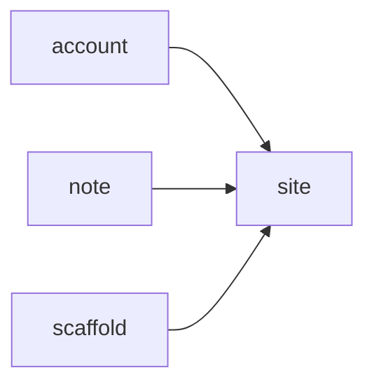

# Code wiki

Generated by `composer run build` from the module manifests, `build/surface.json` and the code index; an edit here fails gate:24. How AIC works: [the architecture pages](../../framework/docs/README.md).

## Modules

| Module | Namespace | Requires | Required by | Routes | Classes |
| --- | --- | --- | --- | --- | --- |
| [site](modules/site.md) | `App\Site\` | none | account, note, scaffold | Api 2, Page 8, Stream 2 | 28 |
| [account](modules/account.md) | `App\Account\` | site | none | Page 8 | 15 |
| [note](modules/note.md) | `App\Note\` | site | none | Page 7 | 26 |
| [scaffold](modules/scaffold.md) | `App\Scaffold\` | site | none | Api 1, Page 3 | 9 |

## Theme

Every component, layout and asset lives in `themes/app/` (#153). The page `themes/app/layouts/page.tpl.php` reads `App\Theme\Layouts\Page`, whose regions are header, content, nav, footer; the document is `themes/app/layouts/html.tpl.php`.

| Component | Template |
| --- | --- |
| `App\Theme\Components\Greetings\Greetings` | `themes/app/components/Greetings/greetings.tpl.php` |
| `App\Theme\Components\Home\Home` | `themes/app/components/Home/home.tpl.php` |
| `App\Theme\Components\LineList\LineList` | `themes/app/components/LineList/line-list.tpl.php` |
| `App\Theme\Components\NoteCard\NoteCard` | `themes/app/components/NoteCard/note-card.tpl.php` |
| `App\Theme\Components\NoteList\NoteList` | `themes/app/components/NoteList/note-list.tpl.php` |
| `App\Theme\Components\ScaffoldAboutView\ScaffoldAboutView` | `themes/app/components/ScaffoldAboutView/scaffold-about-view.tpl.php` |
| `App\Theme\Components\ScaffoldCard\ScaffoldCard` | `themes/app/components/ScaffoldCard/scaffold-card.tpl.php` |
| `App\Theme\Components\SiteNav\SiteNav` | `themes/app/components/SiteNav/site-nav.tpl.php` |
| `App\Theme\Components\StockLinks\StockLinks` | `themes/app/components/StockLinks/stock-links.tpl.php` |
| `App\Theme\Components\StockListing\StockListing` | `themes/app/components/StockListing/stock-listing.tpl.php` |
| `App\Theme\Components\Ticks\Ticks` | `themes/app/components/Ticks/ticks.tpl.php` |

## Requires

## Routes by kind

| Kind | Routes |
| --- | --- |
| Api | 3 |
| Page | 26 |
| Stream | 2 |

| Method | Path | Kind | Module | Handler |
| --- | --- | --- | --- | --- |
| GET | `/api/status` | Api | [site](modules/site.md) | `App\Site\Controller\StatusApi` |
| GET | `/health` | Api | [site](modules/site.md) | `App\Site\Controller\HealthApi` |
| GET | `/download/{file}` | Stream | [site](modules/site.md) | `App\Site\Controller\ResourceDownload` |
| GET | `/events` | Stream | [site](modules/site.md) | `App\Site\Controller\TickEvents` |
| GET | `/ticks` | Page | [site](modules/site.md) | `App\Site\Controller\TicksPage` |
| GET | `/` | Page | [site](modules/site.md) | `App\Site\Controller\HomePage` |
| GET | `/hello/{name}` | Page | [site](modules/site.md) | `App\Site\Controller\GreetingPage` |
| POST | `/hello` | Page | [site](modules/site.md) | `App\Site\Controller\GreetingPost` |
| GET | `/jobs` | Page | [site](modules/site.md) | `App\Site\Controller\JobsPage` |
| POST | `/jobs` | Page | [site](modules/site.md) | `App\Site\Controller\JobsPost` |
| GET | `/notifications` | Page | [site](modules/site.md) | `App\Site\Controller\NotificationsPage` |
| POST | `/notifications` | Page | [site](modules/site.md) | `App\Site\Controller\NotificationsPost` |
| GET | `/login` | Page | [account](modules/account.md) | `App\Account\Controller\LoginPage` |
| POST | `/login` | Page | [account](modules/account.md) | `App\Account\Controller\LoginPost` |
| POST | `/logout` | Page | [account](modules/account.md) | `App\Account\Controller\LogoutPost` |
| GET | `/account` | Page | [account](modules/account.md) | `App\Account\Controller\AccountPage` |
| GET | `/visits` | Page | [account](modules/account.md) | `App\Account\Controller\VisitsPage` |
| POST | `/visits/forget` | Page | [account](modules/account.md) | `App\Account\Controller\VisitsForget` |
| GET | `/uploads` | Page | [account](modules/account.md) | `App\Account\Controller\UploadsPage` |
| POST | `/uploads` | Page | [account](modules/account.md) | `App\Account\Controller\UploadsPost` |
| GET | `/notes` | Page | [note](modules/note.md) | `App\Note\Controller\NoteListPage` |
| POST | `/notes` | Page | [note](modules/note.md) | `App\Note\Controller\NoteCreatePost` |
| GET | `/notes/{id:int}` | Page | [note](modules/note.md) | `App\Note\Controller\NoteShowPage` |
| POST | `/notes/{id:int}` | Page | [note](modules/note.md) | `App\Note\Controller\NoteUpdatePost` |
| POST | `/notes/{id:int}/delete` | Page | [note](modules/note.md) | `App\Note\Controller\NoteDeletePost` |
| GET | `/stock` | Page | [note](modules/note.md) | `App\Note\Controller\StockPage` |
| POST | `/stock` | Page | [note](modules/note.md) | `App\Note\Controller\StockPost` |
| GET | `/scaffold` | Page | [scaffold](modules/scaffold.md) | `App\Scaffold\Controller\ScaffoldPage` |
| GET | `/scaffold/about` | Page | [scaffold](modules/scaffold.md) | `App\Scaffold\Controller\ScaffoldAboutPage` |
| POST | `/scaffold` | Page | [scaffold](modules/scaffold.md) | `App\Scaffold\Controller\ScaffoldPost` |
| GET | `/api/scaffold` | Api | [scaffold](modules/scaffold.md) | `App\Scaffold\Controller\ScaffoldApi` |

## Commands

| Name | Module | Class |
| --- | --- | --- |
| `db:ping` | site | `App\Site\Command\DatabasePing` |
| `greet` | site | `App\Site\Command\Greet` |
| `migrate` | framework | `AIC\Schema\Application\MigrateCommand` |
| `migrate:status` | framework | `AIC\Schema\Application\MigrationStatusCommand` |
| `queue:work` | framework | `AIC\Queue\Application\QueueWorkCommand` |
| `scaffold:hello` | scaffold | `App\Scaffold\Command\ScaffoldHello` |
| `schedule:run` | framework | `AIC\Schedule\Application\ScheduleRunCommand` |
| `user:add` | account | `App\Account\Command\UserAdd` |

## Jobs

| Name | Module | Class |
| --- | --- | --- |
| `demo` | site | `App\Site\Job\DemoJob` |
| `notify` | framework | `AIC\Notification\Application\DeliverNotification` |
| `scaffold-hello` | scaffold | `App\Scaffold\Job\ScaffoldHelloJob` |

## Schedules

| Name | Cadence | Job | Module |
| --- | --- | --- | --- |
| `demo-every-minute` | `* * * * *` | `demo` | site |
