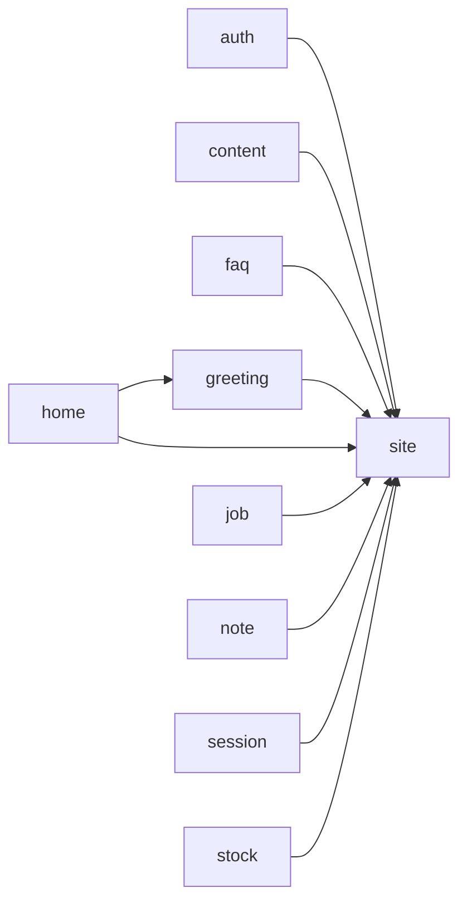

# Code wiki

Generated by `composer run build` from the module manifests, `build/surface.json` and the code index; an edit here fails gate:24. How AIC works: [the architecture pages](../../framework/docs/README.md).

## Modules

| Module | Namespace | Requires | Required by | Routes | Classes |
| --- | --- | --- | --- | --- | --- |
| [site](modules/site.md) | `App\Site\` | none | auth, content, faq, greeting, home, job, note, session, stock | Api 2, Page 1, Stream 4 | 20 |
| [auth](modules/auth.md) | `App\Auth\` | site | none | Page 4 | 9 |
| [content](modules/content.md) | `App\Content\` | site | none | Page 5 | 15 |
| [faq](modules/faq.md) | `App\Faq\` | site | none | Api 1, Page 1 | 9 |
| [greeting](modules/greeting.md) | `App\Greeting\` | site | home | Page 2 | 9 |
| [home](modules/home.md) | `App\Home\` | site, greeting | none | Page 1 | 5 |
| [job](modules/job.md) | `App\Job\` | site | none | Page 4 | 10 |
| [note](modules/note.md) | `App\Note\` | site | none | Page 5 | 20 |
| [session](modules/session.md) | `App\Session\` | site | none | Page 4 | 6 |
| [stock](modules/stock.md) | `App\Stock\` | site | none | Page 2 | 14 |

## Requires

## Routes by kind

| Kind | Routes |
| --- | --- |
| Api | 3 |
| Page | 29 |
| Stream | 4 |

| Method | Path | Kind | Module | Handler |
| --- | --- | --- | --- | --- |
| GET | `/api/status` | Api | [site](modules/site.md) | `App\Site\Controller\StatusApi` |
| GET | `/health` | Api | [site](modules/site.md) | `App\Site\Controller\HealthApi` |
| GET | `/download/{file}` | Stream | [site](modules/site.md) | `App\Site\Controller\ResourceDownload` |
| GET | `/assets/{file}` | Stream | [site](modules/site.md) | `App\Site\Controller\AssetFile` |
| GET | `/assets/{dir}/{file}` | Stream | [site](modules/site.md) | `App\Site\Controller\AssetFile` |
| GET | `/events` | Stream | [site](modules/site.md) | `App\Site\Controller\TickEvents` |
| GET | `/ticks` | Page | [site](modules/site.md) | `App\Site\Controller\TicksPage` |
| GET | `/login` | Page | [auth](modules/auth.md) | `App\Auth\Controller\LoginPage` |
| POST | `/login` | Page | [auth](modules/auth.md) | `App\Auth\Controller\LoginPost` |
| POST | `/logout` | Page | [auth](modules/auth.md) | `App\Auth\Controller\LogoutPost` |
| GET | `/account` | Page | [auth](modules/auth.md) | `App\Auth\Controller\AccountPage` |
| GET | `/pages` | Page | [content](modules/content.md) | `App\Content\Controller\ContentListPage` |
| GET | `/pages/{slug}` | Page | [content](modules/content.md) | `App\Content\Controller\ContentShowPage` |
| POST | `/account/pages` | Page | [content](modules/content.md) | `App\Content\Controller\ContentNewPost` |
| GET | `/account/pages/{slug}` | Page | [content](modules/content.md) | `App\Content\Controller\ContentEditPage` |
| POST | `/account/pages/{slug}` | Page | [content](modules/content.md) | `App\Content\Controller\ContentSavePost` |
| GET | `/faq` | Page | [faq](modules/faq.md) | `App\Faq\Controller\FaqPage` |
| GET | `/api/faq` | Api | [faq](modules/faq.md) | `App\Faq\Controller\FaqApi` |
| GET | `/hello/{name}` | Page | [greeting](modules/greeting.md) | `App\Greeting\Controller\GreetingPage` |
| POST | `/hello` | Page | [greeting](modules/greeting.md) | `App\Greeting\Controller\GreetingPost` |
| GET | `/` | Page | [home](modules/home.md) | `App\Home\Controller\HomePage` |
| GET | `/jobs` | Page | [job](modules/job.md) | `App\Job\Controller\JobsPage` |
| POST | `/jobs` | Page | [job](modules/job.md) | `App\Job\Controller\JobsPost` |
| GET | `/notifications` | Page | [job](modules/job.md) | `App\Job\Controller\NotificationsPage` |
| POST | `/notifications` | Page | [job](modules/job.md) | `App\Job\Controller\NotificationsPost` |
| GET | `/notes` | Page | [note](modules/note.md) | `App\Note\Controller\NoteListPage` |
| POST | `/notes` | Page | [note](modules/note.md) | `App\Note\Controller\NoteCreatePost` |
| GET | `/notes/{id:int}` | Page | [note](modules/note.md) | `App\Note\Controller\NoteShowPage` |
| POST | `/notes/{id:int}` | Page | [note](modules/note.md) | `App\Note\Controller\NoteUpdatePost` |
| POST | `/notes/{id:int}/delete` | Page | [note](modules/note.md) | `App\Note\Controller\NoteDeletePost` |
| GET | `/visits` | Page | [session](modules/session.md) | `App\Session\Controller\VisitsPage` |
| POST | `/visits/forget` | Page | [session](modules/session.md) | `App\Session\Controller\VisitsForget` |
| GET | `/uploads` | Page | [session](modules/session.md) | `App\Session\Controller\UploadsPage` |
| POST | `/uploads` | Page | [session](modules/session.md) | `App\Session\Controller\UploadsPost` |
| GET | `/stock` | Page | [stock](modules/stock.md) | `App\Stock\Controller\StockPage` |
| POST | `/stock` | Page | [stock](modules/stock.md) | `App\Stock\Controller\StockPost` |

## Commands

| Name | Module | Class |
| --- | --- | --- |
| `db:ping` | site | `App\Site\Command\DatabasePing` |
| `greet` | greeting | `App\Greeting\Command\Greet` |
| `migrate` | framework | `AIC\Schema\Application\MigrateCommand` |
| `migrate:status` | framework | `AIC\Schema\Application\MigrationStatusCommand` |
| `queue:work` | framework | `AIC\Queue\Application\QueueWorkCommand` |
| `schedule:run` | framework | `AIC\Schedule\Application\ScheduleRunCommand` |
| `user:add` | auth | `App\Auth\Command\UserAdd` |

## Jobs

| Name | Module | Class |
| --- | --- | --- |
| `demo` | job | `App\Job\Job\DemoJob` |
| `notify` | framework | `AIC\Notification\Application\DeliverNotification` |

## Schedules

| Name | Cadence | Job | Module |
| --- | --- | --- | --- |
| `demo-every-minute` | `* * * * *` | `demo` | job |
